# OTAS — Capital DLC Edition
## An ACTOR Framework for Tokenized Capital

**Capital Development Lifecycle: Activate → Channel → Transform → Orchestrate → Return**  
Expanded edition outline, reference paragraphs, interface catalogue, and illustrations  
Revised 19 November 2026 • Editorial proposal for review

## Reading this edition

This edition organizes tokenized capital through ACTOR and develops every main section. Each section includes its purpose, named subsections, paragraph guidance, and a contextual diagram. Section 5 follows capital activity; Section 6 proposes the interfaces needed to support that activity; Section 7 evaluates the attributes that make those interfaces and tokens usable and verifiable.

The four areas discussed in the current OTAS whitepaper—settlement, identity, compliance, and asset metadata—provide a starting point [1]. Capital DLC requires a broader interface investigation, including commitments, issuance, funding, orders, custody, valuation, servicing, distributions, redemption, reconciliation, governance, and recovery. This proposed catalogue must be tested against actual journeys rather than treated as a complete or adopted standard.

The diagrams show responsibilities, conditions, state changes, and evidence. An arrow indicates an information or process dependency; it does not by itself promise atomicity, legal finality, or the movement of money.

## Contents

| Section | Subject | Main output |
|---|---|---|
| 1 | Executive Summary | The problem, proposed framing, principal contribution, and decisions needed |
| 2 | Capital DLC: Purpose, Actors, and Scope | Economic purposes, responsibilities, and system boundaries |
| 3 | Fragmentation Across the Capital Lifecycle | Gaps linked to explicit requirements |
| 4 | A Common Token Model | Roles, claims, lifecycle states, behaviors, authority, events, and evidence |
| 5 | ACTOR Capital Domains | Activate, Channel, Transform, Orchestrate, and Return |
| 6 | Capital DLC Interface Architecture | An expanded catalogue of functional contracts and their dependencies |
| 7 | Token Attributes, Assurance, and Usability | Identity, rights, privacy, audit, custody, accounting, governance, and operational qualities |
| 8 | Reference Journeys and Validation | Worked journeys, failure cases, and testable outcomes |
| 9 | Conclusions and Next Steps | Findings, open decisions, and a bounded work programme |
| Appendices | Sources, standards survey plan, evidence register, and writing template | Supporting detail and traceability |

## 1. Executive Summary

**Purpose:** Let a reader understand the contribution and the decisions needed without reading the whole paper.

### 1.1 The lifecycle problem

Explain that a usable investment depends on connected commitments, funding, rights, ownership records, servicing, and return of proceeds. Describe one break in that chain through a concrete journey. Keep market-size claims out unless verified and directly relevant.

### 1.2 The Capital DLC framing

Introduce ACTOR as five economic purposes. Explain that token lifecycle states run alongside these purposes and that the same economic journey may use several tokens and conventional records.

### 1.3 The expanded contribution

Summarize the common token model, expanded interface catalogue, and shared attributes. State the distinction between a business domain, an interface contract, and an assurance property so the reader understands how later sections connect.

### 1.4 Findings, maturity, and next decisions

State which gaps the proposed architecture makes explicit and which claims remain untested. Ask for review of responsibility boundaries, interface semantics, evidence requirements, and selected reference journeys. Write this subsection last so it reflects the completed analysis.

**Paragraph sequence:** P1: lifecycle problem and example. P2: ACTOR and the token model. P3: expanded interfaces and shared attributes. P4: limitations and the next review decisions.

**Reference paragraph:** Capital DLC examines how capital is activated, channeled, transformed, orchestrated, and returned, and how token representations support those activities. The proposed edition connects economic purpose to token states, functional interfaces, and verifiable evidence. Its contribution is a lifecycle-wide research structure that makes missing responsibilities and integration requirements visible. The next step is to validate the proposed contracts and controls through bounded instrument journeys and explicit failure cases.

**Figure 1. ACTOR connects economic purpose, token actions, and assurance**

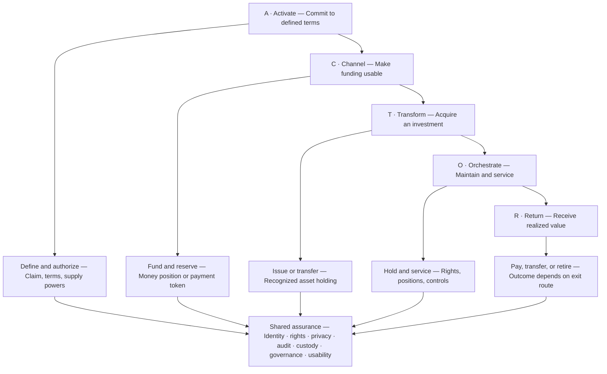

*Read each column from capital purpose to token action. The shared assurance conditions apply across all five domains. ACTOR can repeat; distributions do not require retirement.*

## 2. Capital DLC: Purpose, Actors, and Scope

**Purpose:** Establish a shared vocabulary and make the responsible parties visible before introducing technical contracts.

### 2.1 Five capital purposes

Define A as turning interest into committed funding; C as moving usable funds; T as deploying capital into investments; O as coordinating ownership and servicing; and R as distributing realized value. Explain that purposes can overlap and recur. A secondary transaction can repeat funding and acquisition, while income can be returned repeatedly during an instrument's life.

### 2.2 Capital, instrument, and token

Distinguish the economic commitment, the underlying instrument or claim, and its digital representation. Describe how a payment token and an asset token can participate in the same investment. Name the authoritative records that connect those objects; leave detailed states to Section 4.

### 2.3 Participants and responsibility

Describe the roles of issuer, investor, intermediary, registrar, custodian, cash operator, servicer, and evidence reviewer. A single institution may hold several roles. For each action, name the party that may request it, the party that authorizes it, and the party that confirms the outcome.

### 2.4 Domain, interface, and attribute

A domain groups an economic purpose, such as Channeling Liquidity. An interface defines an exchange or operation, such as requesting a funding reservation and receiving its status. An attribute constrains or qualifies the operation, such as privacy, authority, or traceability. Identity, privacy, and audit may require functional interfaces as well as qualities applied to every other interface.

### 2.5 Scope and external responsibilities

The Capital DLC edition studies the wider business journey. Token contracts and common interfaces describe selected actions and evidence, while institutions and platforms perform operations such as custody, policy decisions, bank transfers, servicing, and dispute resolution. The published OTAS lab scope separates its token/interface contributions from complete platform orchestration [2]. Describe these dependencies as integration requirements without assuming they are delivered by an on-chain standard.

**Paragraph sequence:** P1: economic journey. P2: represented objects and records. P3: participants and powers. P4: architectural vocabulary. P5: scope and responsibility boundaries.

**Reference paragraph:** Capital DLC brings together the economic journey and the systems that make it operable. ACTOR identifies the purpose of each activity, while the token model describes the claims and positions involved. Interfaces connect responsible parties, and shared attributes qualify how those connections may be used. This separation allows a broader lifecycle analysis while keeping responsibility for each operational and evidential outcome explicit.

**Figure 2. A holding depends on several responsible parties**

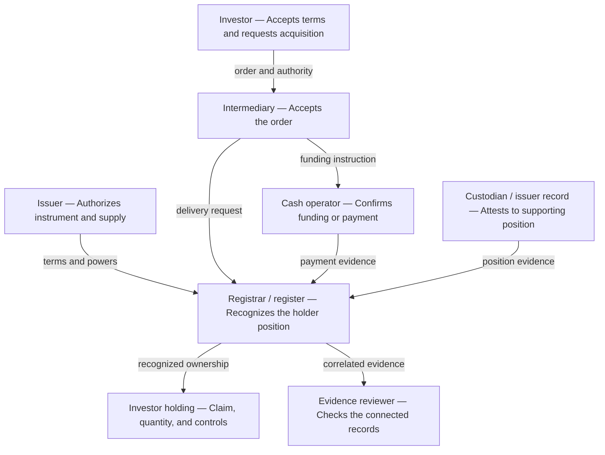

*The investor acquires a holding through linked instructions and records. The issuer, cash operator, registrar, and custodian each supply different evidence; a reviewer needs the correlated record.*

## 3. Fragmentation Across the Capital Lifecycle

**Purpose:** Derive requirements from specific breaks in a journey rather than assuming that a larger list of interfaces solves the problem.

### 3.1 Commitments and instrument meaning

Examine whether accepted terms, participant eligibility, funding commitments, and token configuration refer to the same instrument and version. Ask what happens when an offer changes or a commitment expires. Derive requirements for versioned terms, recorded acceptance, and explicit commitment states.

### 3.2 Funding and spendability

Examine the distinction between a payment being instructed, observed, confirmed, and usable for an investment. Identify conversion, custody, operating-window, and reservation dependencies. Derive requirements for availability evidence and clear release or refund conditions.

### 3.3 Execution, delivery, and ownership

Investigate how an accepted order connects to the cash leg, asset delivery, and authoritative holder record. Separate execution from settlement. Derive requirements for correlation, reservation, ownership recognition, and documented handling of an incomplete exchange.

### 3.4 Servicing and return of value

Examine whether holdings, record dates, entitlement calculations, payment instructions, and actual distributions remain aligned. Derive requirements for versioned entitlements, linked payment outcomes, residual claims, and outstanding-unit reconciliation.

### 3.5 Ledger and institutional differences

Compare relevant account, object, and UTXO representations; authority models; privacy features; and evidence and finality assumptions. Keep a versioned standards survey in Appendix A. Technical feature similarity should be assessed separately from institutional acceptance and instrument rights.

### 3.6 A requirements and evidence register

For each gap, retain the affected actor, trigger, operational consequence, supporting source or scenario, required interface, and validation criterion. Label scenario-based hypotheses clearly. This register links the problem analysis to Sections 6 and 8.

| Gap to investigate | Requirement | Candidate interface | Example validation question |
|---|---|---|---|
| Accepted terms differ from delivered representation | Versioned terms and acceptance | Instrument terms; commitments; issuance | Can an outdated terms version be detected before allocation? |
| Funding appears complete but is unavailable | Explicit spendability conditions | Funding and liquidity | Can the receiver distinguish observed from usable funds? |
| Delivery and holder records disagree | Correlated settlement and position recognition | Settlement; registry and custody | Can the discrepancy be detected and assigned for resolution? |
| Distribution is recorded without confirmed receipt | Linked entitlement and payment outcome | Servicing; distribution; evidence | Can the unpaid entitlement remain visible without duplicating payment? |
| Revocation occurs after an initial approval | Current eligibility at execution | Eligibility; governance; recovery | Is an expired pre-check rejected or refreshed? |

**Paragraph sequence:** P1: observable break. P2: cause and affected actor. P3: evidence or bounded scenario. P4: derived requirement and owner. P5: validation criterion.

**Reference paragraph:** Fragmentation becomes material when connected systems disagree about the same commitment, holding, permission, or payment. A common event name does not resolve an unclear authority or incomplete record. The analysis therefore follows the journey across institutional boundaries and links each identified gap to a responsible interface and a testable requirement. This provides an evidence trail from the problem statement to the proposed architecture.

**Figure 3. Find gaps by comparing the records of one journey**

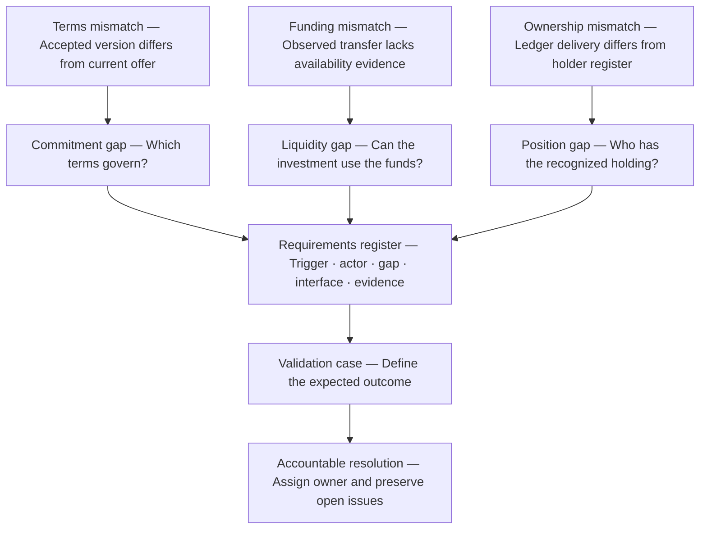

*Three example mismatches lead to explicit requirements and accountable resolution. The gap register preserves the link between the problem, the proposed interface, and its validation case.*

## 4. A Common Token Model

**Purpose:** Define the objects, actions, authorities, and evidence that the ACTOR domains and interface catalogue refer to.

**Paragraph sequence:** P1: represented claims and authoritative records. P2: token roles and states. P3: supported behaviors and control powers. P4: correlated events and evidence. P5: native mappings, limitations, and validation needs.

### 4.1 Keep three lifecycles distinct

Capital activity, the underlying instrument, and its token representation have related but different histories. A bond can remain legally outstanding while a token representation is replaced. An investor can receive income while continuing to hold the same units. A transfer can move an existing token without creating new capital for the issuer.

| Lifecycle | Illustrative changes | Main record or evidence |
|---|---|---|
| Capital | Committed, funded, invested, serviced, returned, reinvested | Agreements, payment confirmations, allocation records, distributions |
| Instrument or claim | Authorized, issued, outstanding, amended, matured, discharged | Authoritative instrument terms and applicable issuer/register records |
| Token representation | Configured, minted, allocated, held, reserved, transferred, retired | Token state, authorization records, correlated ledger events |

The paper should specify how these records relate and how discrepancies are resolved. A token event alone does not establish every economic or legal outcome.

### 4.2 Distinguish token roles

An ACTOR journey can involve several assets. For example, a payment token funds a purchase while an asset token records the acquired claim. An optional receipt may represent an interest in an underlying asset. A separate collateral record may restrict use without creating a new ownership claim.

For each token, identify its role, issuer, represented claim, authoritative record, denomination, current supply, permitted actions, controlling authority, metadata source, and evidence references. Do not assume the same token accompanies capital through every stage.

### 4.3 Model states separately from restrictions and events

| Category | Illustrative values | Interpretation |
|---|---|---|
| Lifecycle state | Configured, authorized, issued, active, redemption pending, retired | The representation's broad status |
| Position or availability | Held, available, reserved, locked, pledged | What a particular holding can currently support |
| Restriction | Paused, frozen, holder ineligible, transfer restricted | A constraint on a party, position, action, or instrument |
| Event | Issued, transferred, distributed, metadata updated, redeemed | A recorded action or outcome |

These are proposed categories, not a mandatory universal state machine. Issuance can occur during formation or deployment, depending on the instrument. A distribution need not change the lifecycle state. A transfer may change ownership while the instrument remains active. Freezing a holding should not be confused with its retirement.

### 4.4 Compose behaviors around a defined use

Group optional behaviors around supply, transfer, reservation, restrictions, servicing, redemption, and recovery. Specify the action's inputs, authorization, preconditions, resulting state, and observable outcome. Avoid assuming that every token must support every behavior. A behavior description should disclose unavailable and unverified functions as well as supported ones.

### 4.5 Describe capabilities and administrative powers

Make supported operations discoverable alongside the authority required to invoke or change them. Separate a participant's authority to request a transfer from an administrator's authority to pause a system or replace a policy. Include the source, version, and verification status of each declaration. Externally inferred capabilities require evidence and should not be treated as issuer attestations.

### 4.6 Correlate instructions, actions, and events

Relate an originating request to authorizations, local transactions, external confirmations, and final position changes. Use stable identifiers and version references where appropriate. Distinguish a request being accepted from its execution and from the economic outcome being confirmed. Define duplicate handling and retry semantics for operations that may be submitted again.

### 4.7 Identify authoritative evidence

For each claim, identify who can assert it, which record is authoritative, when the assertion was valid, and how a later correction is handled. Evidence can include on-chain observations and external records. Integrity checks establish whether content changed; authority and operational reconciliation are separate questions.

### 4.8 Map to execution environments

Evaluate how the model maps onto selected account, object, and UTXO implementations. Record the native operation, any adapter, the trust introduced, and properties that cannot be inferred from the ledger. Assess semantic equivalence through outcomes and evidence rather than function names alone.

**Reference paragraph:** The common token model connects a representation to its claim, holder position, permitted behaviors, and control authorities. It separates lifecycle status from restrictions and records how actions produce evidence. A counterparty should be able to discover what a token supports, who may act, and which records substantiate the resulting position. Where an implementation exposes only part of this information, the description should retain that uncertainty.

**Figure 4. Token status, available use, and servicing are different**

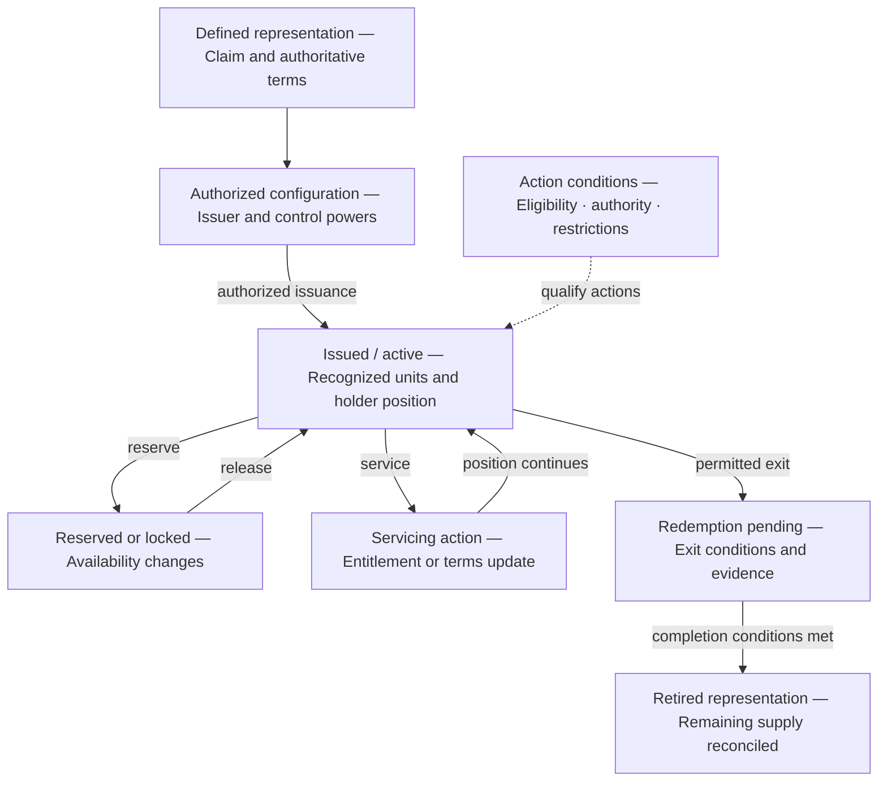

*The active representation can be reserved and released or serviced while remaining outstanding. Retirement follows a completed, authorized exit under the instrument terms. Restrictions qualify actions rather than replacing the whole lifecycle.*

## 5. ACTOR Capital Domains

**Purpose:** Explain the five capital domains through actors, actions, token uses, interface dependencies, and completion evidence.

**Paragraph sequence:** Economic purpose; actors and claims; token actions and interface dependencies; shared attributes and evidence; outcome and exceptions. Section 6 defines the interfaces referenced below.

### 5.1 A — Activating Capital

**Purpose:** Turn investor interest into committed funding.

**Token question:** What is being offered, which rights does it represent, who may participate, and who may authorize its creation?

| Subsection | Subject and paragraph focus |
|---|---|
| 5.1.1 Instrument and claim definition | Describe the instrument, issuer obligations, holder entitlements, identifiers, and authoritative terms. |
| 5.1.2 Participants and authority | Identify issuer, investor, arranger, custodian, registrar, and relevant delegated powers. |
| 5.1.3 Eligibility and consent | Explain participation conditions, disclosures, accepted terms, and the evidence of acceptance. |
| 5.1.4 Commitments and issuance conditions | State when a commitment becomes effective, when issuance is permitted, and how unmet conditions are handled. |
| 5.1.5 Token configuration and discovery | Describe proposed supply, unit structure, permitted behaviors, control roles, and terms references. |

**Lifecycle and usability:** The token definition is prepared and authorized. Tokens may be issued here if the instrument design calls for it; minting is not a universal completion condition. Usability begins with an understandable claim, discoverable terms, and an eligible participant.

**Reference paragraph:** Activating Capital establishes the basis on which an investor can commit funds. The instrument must identify the claim being offered, the party responsible for it, and the conditions governing participation. The token description connects those terms to a proposed digital representation and its authorized controls. The domain's output is a documented commitment and an authorized instrument configuration, supported by the relevant acceptance and approval records.

**Interface dependencies:** Instrument terms, identity and authority, eligibility, commitments and consent, issuance configuration, privacy, and governance.

**Figure 5. Activate: connect accepted terms to an authorized commitment**

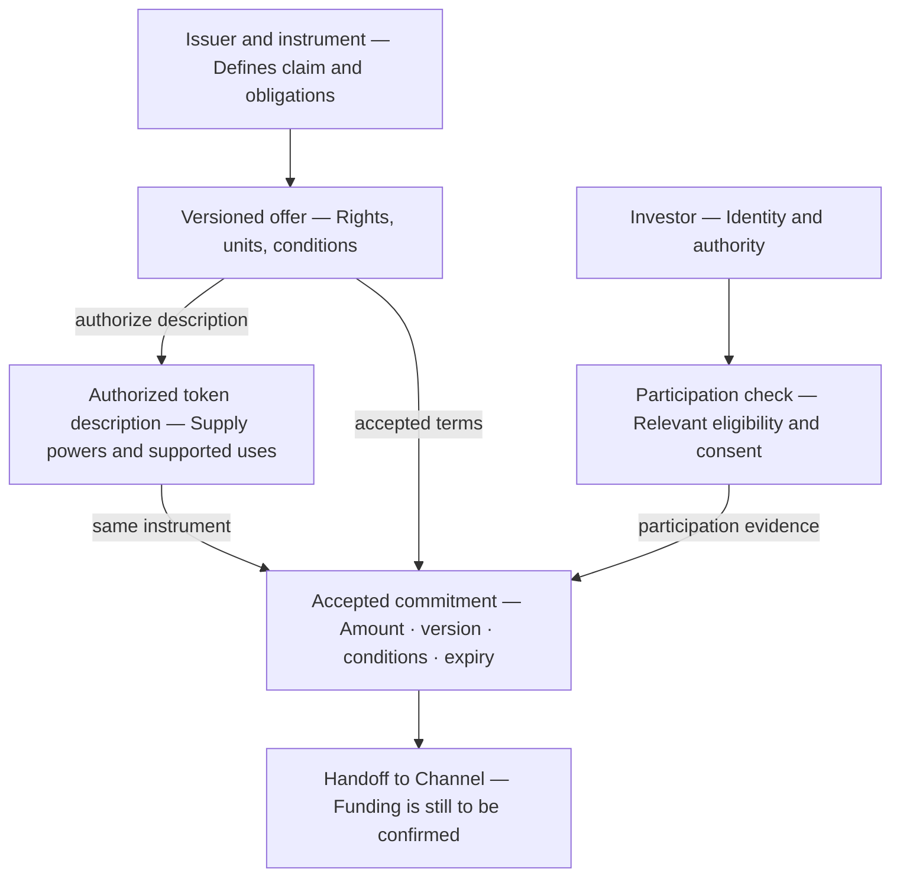

*The result is a documented commitment, not confirmed funding. The investor acceptance, relevant eligibility, and authorized instrument description must refer to the same terms.*

### 5.2 C — Channeling Liquidity

**Purpose:** Move usable funds through financial rails.

**Token question:** Can the required value reach the right destination, in an acceptable form, and become available for the intended transaction?

| Subsection | Subject and paragraph focus |
|---|---|
| 5.2.1 Funding instruments and routes | Identify accepted bank money, deposit tokens, stablecoins, or other funding instruments and the conditions of use. |
| 5.2.2 Accounts, wallets, custody, and access | Explain who controls the funding position and which parties can initiate or approve movement. |
| 5.2.3 Conversion and liquidity availability | Describe currency or instrument conversion, fees, limits, funding windows, and liquidity dependencies. |
| 5.2.4 Reservation and conditional funding | Explain available, reserved, or escrowed balances and conditions for release or refund. |
| 5.2.5 Confirmation, finality, and exceptions | State the evidence needed to treat funds as usable and how delayed, rejected, or misdirected funding is handled. |

**Lifecycle and usability:** Funding positions move, convert, or become reserved. The investment token may still be unissued or awaiting delivery. Usability depends on access, acceptance by the receiving arrangement, spendability, and completion conditions.

**Reference paragraph:** Channeling Liquidity concerns the movement and availability of funds needed for an investment or payment. The domain identifies the accepted funding instrument, the accounts and rails involved, and the point at which the receiving party can use the value. Token interfaces can describe balances, restrictions, and transfer evidence, while external operators execute bank transfers, conversion, and custody processes. The output is confirmed usable funding, or a clearly recorded exception requiring resolution.

**Interface dependencies:** Funding and liquidity, identity and authority, eligibility, custody access, settlement evidence, and exception handling.

**Figure 6. Channel: make accepted funding available for use**

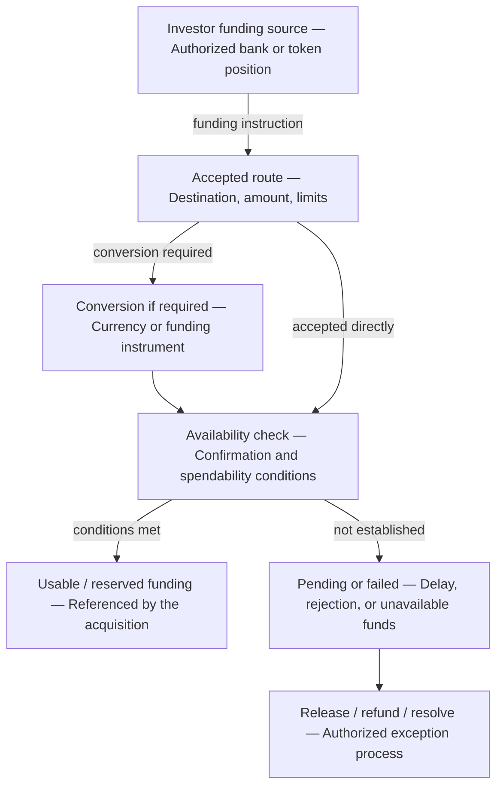

*A funding instruction can remain pending, become usable, or fail. Conversion and reservation are arrangement-specific. Each path needs evidence and a defined release or recovery action.*

### 5.3 T — Transforming Assets

**Purpose:** Deploy capital into investments.

**Token question:** How does funded value become a verified holding, allocation, or investment position?

| Subsection | Subject and paragraph focus |
|---|---|
| 5.3.1 Subscription, purchase, or allocation | Define the action through which an investor acquires an interest and the conditions for acceptance. |
| 5.3.2 Issuance and representation | Explain authorization to mint or allocate, the represented claim, and the relationship to backing or authoritative records. |
| 5.3.3 Exchange and settlement | Link payment and asset delivery, including reservations, evidence, finality assumptions, and failure paths. |
| 5.3.4 Ownership and position recognition | Identify the authoritative holder record and reconciliation between custody, registers, and ledgers. |
| 5.3.5 Permitted investment uses | Assess transfer, portfolio holding, approved collateral use, or integration with other systems according to instrument terms. |

**Lifecycle and usability:** Tokens may be minted, allocated, delivered, or transferred. In a secondary transaction the same units may simply change holders. The domain must distinguish buying an existing position from funding new issuance.

**Reference paragraph:** Transforming Assets connects funded value to a recognized investment position. The transaction may involve new issuance, allocation from existing inventory, or transfer between holders. Token actions must be associated with the correct payment evidence, authorization, and authoritative ownership record. The result is an identifiable holding whose permitted uses and remaining restrictions are visible to the holder and relevant counterparties.

**Interface dependencies:** Orders and execution, issuance or allocation, settlement, ownership registry, custody or backing assertions, and reconciliation.

**Figure 7. Transform: link execution, settlement, and ownership recognition**

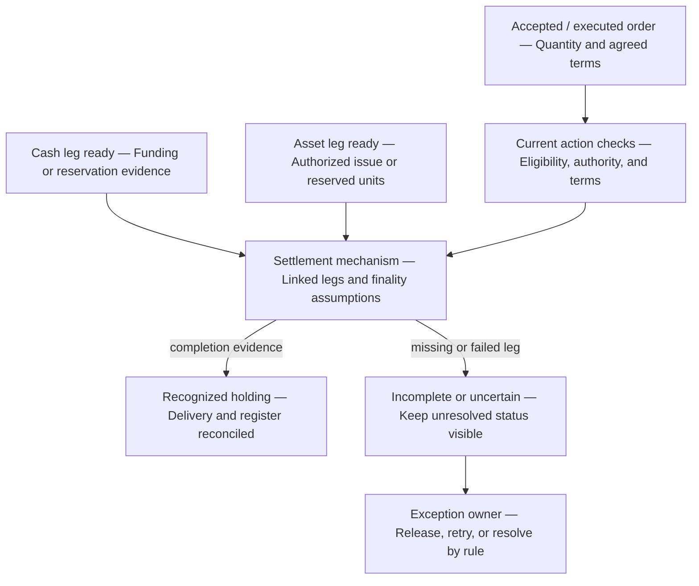

*Payment readiness and asset readiness meet at a declared settlement mechanism. Its outcome must be linked to the authoritative holder record; an unresolved leg requires an exception rather than an assumed completed holding.*

### 5.4 O — Orchestrating Asset Lifecycles

**Purpose:** Coordinate ownership, servicing, and reconciliation.

**Token question:** How does an outstanding token remain accurate, useful, controlled, and serviceable over time?

| Subsection | Subject and paragraph focus |
|---|---|
| 5.4.1 Holdings, custody, and backing | Reconcile holder positions, token supply, and backing or issuer records where applicable. |
| 5.4.2 Valuation, accounting, and reporting evidence | Identify valuation sources, effective times, position records, and information needed by external accounting systems. |
| 5.4.3 Entitlements and servicing events | Describe coupon or dividend entitlement calculation, record dates, voting, amendments, and other instrument events. |
| 5.4.4 Continuing eligibility and control changes | Explain credential refresh, revocation, transfer restrictions, delegated authority, and administrative changes. |
| 5.4.5 Audit, privacy, and exception resolution | Connect lifecycle actions to evidence, controlled disclosure, reconciliation breaks, and recovery responsibilities. |

**Lifecycle and usability:** Tokens remain outstanding while holdings, permissions, valuations, and entitlements change. Locking, pledging, freezing, or recovery may affect what an otherwise active position can do.

**Reference paragraph:** Orchestrating Asset Lifecycles maintains the relationship between a digital holding and the obligations and records supporting it. The domain covers ownership changes, entitlements, valuation references, eligibility updates, and reconciliation. Token events provide an observable interface to those activities, while designated operators perform servicing and resolve exceptions. Its output is an up-to-date, reconcilable position with traceable rights, controls, and servicing status.

**Interface dependencies:** Registry and custody, backing attestations, valuation and accounting, servicing and corporate actions, governance, audit, and recovery.

**Figure 8. Orchestrate: reconcile the position and establish servicing rights**

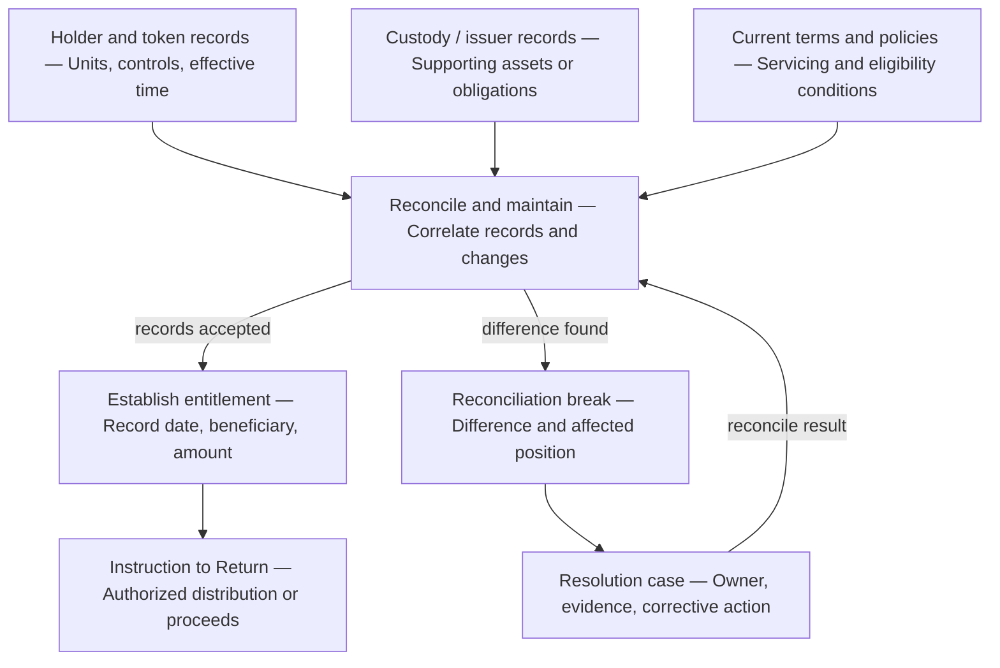

*The token position, supporting record, and applicable terms are compared over time. A reconciled position supports entitlement processing; discrepancies enter an accountable case process.*

### 5.5 R — Returning Realized Value

**Purpose:** Distribute income and realized proceeds to investors.

**Token question:** How does an entitlement or exit produce confirmed value for the holder, and what happens to the holding afterward?

| Subsection | Subject and paragraph focus |
|---|---|
| 5.5.1 Income and proceeds entitlements | Identify the amount or allocation due, relevant terms, record date, and beneficiary. |
| 5.5.2 Distribution and payment | Describe the payment route, permitted deductions, currency, payment status, and evidence of completion. |
| 5.5.3 Sale, redemption, maturity, or liquidation | Distinguish different exit routes, their conditions, and the responsible counterparties. |
| 5.5.4 Cancellation and supply reconciliation | Explain when units transfer, remain active, are cancelled, or are burned, and reconcile the corresponding records. |
| 5.5.5 Closure, residual claims, and reinvestment | Identify remaining rights, failed payments, residual positions, and any new capital deployment. |

**Lifecycle and usability:** Income can be paid while units remain active. A sale generally changes the holder. Redemption may retire units under the instrument's rules. Token retirement and discharge of the underlying claim must be correlated rather than assumed identical.

**Reference paragraph:** Returning Realized Value converts an established entitlement or completed exit into value available to the investor. The domain distinguishes recurring income from sale proceeds, redemption payments, and maturity settlement. Each route requires evidence of entitlement, authorization, payment, and the resulting position. The holding may continue, transfer, or retire, so the completion record must state both the cash outcome and the remaining claim.

**Interface dependencies:** Entitlement servicing, distributions and payments, orders for a sale, redemption and retirement, settlement evidence, reconciliation, and recovery.

**Figure 9. Return: payout routes have different position outcomes**

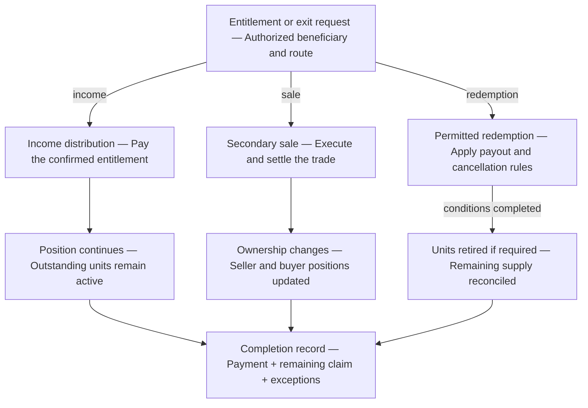

*An income payment can leave units active, a sale changes the holder, and redemption can retire units after the selected completion conditions. Cash and position outcomes must both be recorded.*

## 6. Capital DLC Interface Architecture

**Purpose:** Define functional contracts across the whole capital journey. The catalogue expands beyond the four original areas and should be refined through requirements and validation.

An interface has a caller, a responsible provider, accepted inputs, permitted operations, result semantics, evidence, and failure behavior. Its implementation can combine smart contracts, institutional APIs, and human-controlled operations. Calling an area an interface does not imply it can or should be fully implemented on-chain.

### 6.1 Instrument terms and represented rights

**Inputs:** Instrument identity and requested version. **Actions:** Publish, retrieve, or attest to terms and the token-to-claim relationship. **Outputs:** Versioned rights, obligations, unit definition, authoritative-record references, and publisher evidence. Explain amendment and supersession handling; identify questions requiring external interpretation.

### 6.2 Party identity and delegated authority

**Inputs:** Party, wallet or account, action, and context. **Actions:** Verify identity binding and authority to act. **Outputs:** Verification result, accepted issuer or authority, validity interval, and delegation references. Separate identification from eligibility and from permission to administer the system.

### 6.3 Eligibility and policy decisions

**Inputs:** Parties, instrument, action, amount, jurisdictional or venue context, and relevant version references. **Actions:** Evaluate or validate applicable conditions. **Outputs:** Allow, deny, or indeterminate status with suitably disclosed reasons, validity conditions, and enforcement references. Explain when an earlier result must be refreshed at execution.

### 6.4 Offers, commitments, and consent

**Inputs:** Offer or terms version, participant, amount, acceptance, and conditions. **Actions:** Record acceptance, reserve a commitment, withdraw where permitted, or mark expiry. **Outputs:** Commitment status, accepted scope, expiry, authorization, and linked evidence. Do not represent an accepted commitment as settled funding.

### 6.5 Issuance, allocation, and supply controls

**Inputs:** Issuance authority, instrument, unit amount, eligible recipient, and required supporting evidence. **Actions:** Authorize minting, issue, allocate, or cancel under the applicable design. **Outputs:** Resulting units and supply, allocation records, approval references, and rejection information. Distinguish newly created supply from transfer of existing inventory.

### 6.6 Funding, liquidity, and conversion

**Inputs:** Funding source, destination, instrument, amount, conversion conditions, and transaction reference. **Actions:** Request funding, reserve value, convert where supported, release, refund, and query status. **Outputs:** Observed, confirmed, available, reserved, rejected, or unresolved status as defined by the operator, with spendability conditions and evidence.

### 6.7 Orders, exchange, and execution

**Inputs:** Buy, sell, subscription, or other supported order; quantity; terms; price conditions; participant; and limits. **Actions:** Accept, reject, amend or cancel where permitted, execute, and report. **Outputs:** Order status and execution details linked to settlement obligations. An execution report is not a completed settlement record.

### 6.8 Settlement coordination and finality

**Inputs:** Linked obligations, reservation references, participants, mechanism, and finality conditions. **Actions:** Propose, validate, coordinate, query, complete, or handle failure according to the declared mechanism. **Outputs:** Leg status, completion evidence, irrevocability and finality references, or exception status. Specify atomicity assumptions separately from ledger and legal finality.

### 6.9 Ownership registry, custody, and positions

**Inputs:** Instrument, holder or custody account, effective time, and authorized changes. **Actions:** Record or retrieve holdings, recognize delivery, restrict availability, or attest to custody. **Outputs:** Authoritative-position references, quantity, availability, control party, and reconciliation status. Distinguish a ledger address from the relevant holder or custody relationship.

### 6.10 Backing and external attestations

**Inputs:** Representation, supporting asset or obligation, applicable ratio, time, and authorized evidence source. **Actions:** Obtain or verify an attestation and compare it with outstanding representation. **Outputs:** Attested scope, date, source, limitations, and discrepancies. Some instruments depend on issuer obligations rather than segregated asset backing; describe the applicable relationship.

### 6.11 Valuation, position accounting, and postings

**Inputs:** Position, pricing or NAV source, time, currency, fees, and relevant events. **Actions:** Retrieve valuations, calculate a stated measure, export posting information, and reconcile. **Outputs:** Valuation with basis and timestamp, transaction effects, posting references, and unresolved differences. Applicable accounting treatment remains an external institutional determination.

### 6.12 Entitlements, servicing, and corporate actions

**Inputs:** Instrument terms, eligible positions, record date, event type, elections, and authority. **Actions:** Establish an entitlement, record an election, process an authorized change, or report servicing status. **Outputs:** Versioned beneficiary entitlements, action results, and instructions for payment or position updates. Keep entitlement calculation distinct from payment completion.

### 6.13 Distributions, payments, and proceeds

**Inputs:** Authorized entitlement or proceeds instruction, beneficiary, amount, route, deductions, and currency. **Actions:** Instruct, approve, query, confirm, or resolve a payment. **Outputs:** Payment status, confirmed value, remaining unpaid amount, and correlated evidence. Duplicate instructions must not create duplicate distributions.

### 6.14 Exit, redemption, and retirement

**Inputs:** Position, permitted exit route, quantities, applicable terms, and payout or delivery conditions. **Actions:** Request redemption, reserve units, authorize release, cancel or retire representations, and report closure. **Outputs:** Remaining position, retired supply where applicable, proceeds references, and residual claims. A secondary sale ordinarily uses order and settlement contracts rather than requiring retirement.

### 6.15 Audit, reconciliation, and evidence exchange

**Inputs:** Request or event references, records from relevant systems, reconciliation scope, and authorized reviewer. **Actions:** Correlate, compare, export evidence, flag differences, and record resolution. **Outputs:** Traceable outcomes and unresolved discrepancies. Explain completeness and source authority rather than assuming a transaction hash proves the whole capital event.

### 6.16 Privacy, disclosure, and access

**Inputs:** Requester, purpose, requested data or proof, subject, and applicable access policy. **Actions:** Authorize disclosure, provide a limited presentation or proof where supported, and record access. **Outputs:** Permitted data or proof, denial, provenance, and disclosure evidence. Data minimization applies to every other interface as well.

### 6.17 Governance and administrative controls

**Inputs:** Authorized proposal or administrative request, applicable policy, affected instrument or service, and approvals. **Actions:** Change controls, pause or resume, rotate authority, approve recovery, or update configuration. **Outputs:** Decision, effective version, authority evidence, and observable change. Distinguish operational administration from holder corporate-action rights.

### 6.18 Exceptions, recovery, and resolution

**Inputs:** Failed action, conflicting evidence, affected positions or obligations, and authorized case owner. **Actions:** Open a case, query status, retry safely, release reservations, correct records where authorized, or escalate. **Outputs:** Recovery result, remaining exposure or restriction, resolution authority, and audit trail. Define what cannot be reversed and what requires a new compensating action.

### 6.19 Capability discovery and interoperability

**Inputs:** Instrument or service, requested action, execution environment, and supported-version constraints. **Actions:** Discover capabilities, compare compatibility, or identify a supported adapter. **Outputs:** Supported, conditional, unsupported, or unknown status with limitations and evidence. Discovery describes claimed support; testing establishes the demonstrated configuration.

### 6.20 Minimum contract template

| Contract element | What the edition should specify |
|---|---|
| Purpose and responsibility | The supported economic action and accountable provider |
| Request | Inputs, identifiers, versions, amounts, time, and context |
| Authority and preconditions | Who may call or approve; required state and eligibility |
| Action and state ownership | What may change, who owns the authoritative state, and external dependencies |
| Results | Success, pending, rejection, indeterminate, and exception meanings |
| Evidence and disclosure | Proof or record references, verification conditions, and permitted visibility |
| Timing and validity | Expiry, freshness, ordering, and finality assumptions |
| Failure and repeat requests | Correlation, idempotency where required, retry, timeout, and recovery rules |

### 6.21 Interface dependencies across ACTOR

| Domain | Principal functional interfaces | Shared support |
|---|---|---|
| A | Terms; commitments; issuance configuration | Identity, eligibility, privacy, governance, discovery, evidence |
| C | Funding; conversion; custody access; settlement status | Identity, eligibility, privacy, recovery, evidence |
| T | Orders; issuance or allocation; settlement; ownership recognition | Backing assertions where relevant, governance, reconciliation |
| O | Positions and custody; backing; valuation; servicing; corporate actions | Current eligibility, controls, privacy, evidence, recovery |
| R | Distribution; orders for sale; redemption and retirement; settlement evidence | Beneficiary authority, accounting, reconciliation, recovery |

**Paragraph sequence:** P1: economic action and accountable provider. P2: request, preconditions, and allowed changes. P3: result states and authoritative evidence. P4: disclosure and operational constraints. P5: failure paths, compatibility, and test questions.

**Reference paragraph:** Capital DLC needs interfaces for the actions that form, fund, acquire, maintain, and return an investment. Settlement, identity, policy, and metadata participate in that architecture, while additional contracts establish commitments, supply, orders, custody positions, entitlements, distributions, exits, and recovery. Each contract must identify its state owner and verifiable outcome. The catalogue is evaluated through complete journeys so that both missing operations and redundant abstractions can be identified.

**Figure 10. The expanded interfaces connect a complete investment journey**

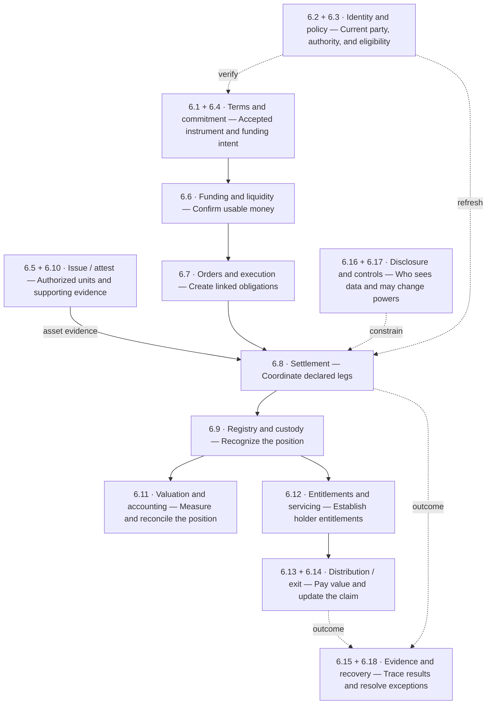

*Numbers refer to Section 6. The example adds commitments, funding, orders, issuance, registry, servicing, and distributions to settlement. Identity, policy, privacy, recovery, and evidence qualify the operations throughout.*

## 7. Token Attributes, Assurance, and Usability

**Purpose:** Evaluate the qualities and constraints that make the functional interfaces and represented positions usable and trustworthy.

Treat these as shared attributes assessed throughout ACTOR and across the interface catalogue. Each domain selects the relevant checks. An identity-verification interface exchanges identity evidence; identity assurance describes whether that evidence is adequate for the action. The same distinction applies to audit and privacy.

**Paragraph sequence:** P1: attribute and affected action. P2: required capability or constraint. P3: source and verification evidence. P4: ACTOR-specific changes and failure behavior. P5: limitations and evaluation criteria.

| Attribute domain | Central question | Illustrative evidence or capability |
|---|---|---|
| 7.1 Identity and delegated authority | Who is acting, for whom, and with which powers? | Party identifiers, wallet binding, signatory and delegation references |
| 7.2 Rights and instrument terms | What does the holder own or claim? | Authoritative terms, issuer obligations, entitlement and redemption references |
| 7.3 Eligibility and policy controls | Is this party permitted to perform this action now? | Valid claims, policy version, decision result, execution-time enforcement |
| 7.4 Metadata and provenance | Which description is authoritative and current? | Signed record, version, publisher authority, integrity anchor, update events |
| 7.5 Custody, backing, and supply integrity | Where is the asset or obligation recorded, and how does supply reconcile? | Custody statements or issuer records, mint authority, reconciled supply and positions |
| 7.6 Privacy and controlled disclosure | Who can see which data, and what can be proven without exposing it? | Access policy, selective disclosure or proofs where supported, data-minimization design |
| 7.7 Audit and accountability | Can an action and its outcome be reconstructed and attributed? | Correlated instructions, authorizations, events, external confirmations, reconciliation records |
| 7.8 Valuation and accounting | How are the position and cash effects measured and recorded? | Price or NAV source and timestamp, currency, fees, posting and reconciliation references |
| 7.9 Security and governance | Who can change rules, upgrade systems, recover access, or override normal behavior? | Role definitions, approval records, key-control policy, upgrade and recovery evidence |
| 7.10 Interoperability and portability | Can another system interpret and act on this token's supported functions? | Capability discovery, semantic mapping, compatible interfaces, acceptance conditions |
| 7.11 Usability and access | Can the intended participant complete the permitted action in practice? | Supported wallets and custody, understandable terms, costs, latency, limits, support and recovery |
| 7.12 Operational resilience and finality | What happens during failure, and which outcomes can be relied upon? | Availability assumptions, finality evidence, timeout handling, recovery and reconciliation procedures |

Privacy capabilities must be stated as supported features of a specific implementation. A shared vocabulary alone does not make identity or transaction data private. Auditability similarly depends on evidence completeness and authoritative external records as well as ledger history.

### 7.1 Identity and delegated authority

Explain the relationship among a legal party, its identifiers, controlled accounts, and authorized signers. State the evidence, assurance level, delegation scope, and validity needed for the action. Show how authority is refreshed or revoked. A valid identity does not establish permission for every transaction.

### 7.2 Rights and instrument terms

Describe economic and control rights, obligations, transfer conditions, and exit terms. Identify the authoritative text and version accepted by the participant. Link token actions to that instrument without assuming that shared identifiers create interchangeable rights.

### 7.3 Eligibility and policy controls

Define the applicable action and the conditions evaluated. Distinguish a policy decision from evidence of that decision and from the mechanism enforcing it. Explain stale pre-checks, unavailable checks, and any permitted escalation.

### 7.4 Metadata and provenance

Explain who may describe or amend the instrument, how a consumer discovers the current record, and how superseded versions remain interpretable. Separate content integrity from publisher authority. State how availability failures affect a proposed action.

### 7.5 Custody, backing, and supply integrity

Define the relationship between outstanding representations, holder positions, and external assets or issuer obligations. Identify the relevant custody or issuer record, effective time, and reconciliation method. Explain how a discrepancy restricts issuance, transfers, or redemptions under the selected arrangement.

### 7.6 Privacy and controlled disclosure

Identify which actor can receive which data for each action. Describe supported disclosure controls and proofs, and the data they reveal or conceal. Include metadata leakage and the handling of evidence outside the ledger. State implementation-specific limitations rather than assuming a standard creates confidentiality.

### 7.7 Audit and accountability

Trace a request through authorization, execution, external confirmation, and resulting position. Identify the source of each record and access required by a reviewer. Explain how evidence gaps, corrections, or inconsistent timestamps are handled and how unresolved differences remain visible.

### 7.8 Valuation and accounting

State the measure, pricing basis, currency, effective time, and data source. Link holdings and cash changes to the records used by external accounting processes. Preserve fees and unresolved amounts. Distinguish economic valuation from ledger quantities and from institutional accounting treatment.

### 7.9 Security and governance

Describe privileged powers, approval requirements, key control, upgrades, and recovery. Make effective configuration changes observable. Evaluate how compromise, authority revocation, or emergency action affects pending requests and existing holdings.

### 7.10 Interoperability and portability

Assess common meanings, supported actions, version compatibility, accepted evidence, and institutional acceptance. Identify adapters and added trust. Keep semantic compatibility separate from transport connectivity and from the ability to move or recognize the underlying claim.

### 7.11 Usability and access

Evaluate a specific participant completing a specific permitted action. Include wallet or custody support, funding access, understandable terms, costs, limits, operating windows, and recovery. Mark capabilities as supported, conditional, unsupported, or unknown with reasons.

### 7.12 Operational resilience and finality

State service dependencies, expected availability, timeout handling, and recovery responsibilities. Distinguish a message being received, an instruction becoming irrevocable, ledger confirmation, and the arrangement's final settlement conditions. Explain how the participant learns what remains unresolved after a disruption.

### 7.13 How key attributes change across ACTOR

| Attribute | A — Activate | C — Channel | T — Transform | O — Orchestrate | R — Return |
|---|---|---|---|---|---|
| Identity and authority | Identify participants and issuance powers | Authenticate funding authority | Verify acquisition and delivery authority | Refresh credentials and delegations | Verify beneficiaries and exit authority |
| Audit | Trace terms, consent, and commitments | Link instructions to funding confirmation | Link cash, allocation, and ownership | Reconcile holdings and servicing | Link entitlement, payment, and resulting position |
| Privacy | Limit disclosure of investor information | Control exposure of accounts and funding details | Limit disclosure of orders and holdings | Control position and servicing visibility | Protect beneficiary and proceeds information |
| Usability | Make terms and participation conditions understandable | Provide an accepted and accessible funding route | Support acquisition, receipt, and permitted uses | Support custody, servicing, and recovery | Provide practical access to distributions and exit |
| Accounting | Record commitments where required by the arrangement | Reconcile cash movement and conversion | Record acquired positions and transaction costs | Maintain valuations and servicing records | Reconcile realized proceeds and remaining positions |

This is a research and design matrix. Particular accounting treatment and legal obligations depend on the instrument and institution and are not specified by ACTOR labels.

### 7.14 Evaluate usability through a concrete action

A usable token must satisfy the conditions of a particular action for a particular participant, venue, amount, and time. For each proposed use, ask:

1. Do the rights and terms permit it?
2. Does the participant have the required identity, eligibility, and authority?
3. Do the token and receiving system support the necessary behavior?
4. Are the funds, inventory, custody access, and operational support available?
5. Can the outcome be evidenced, reconciled, and recovered if it fails?

Mark results as supported, conditional, unsupported, or unknown, with reasons and evidence. A transferable token may still be unusable for a specific holder or venue. A redeemable token may have redemption windows, thresholds, or access conditions. These conditions belong in the usable-capability description.

**Reference paragraph:** A token's supported function becomes useful only when the relevant rights, authority, operational access, and evidence are adequate for the intended action. The attribute framework evaluates those conditions across every ACTOR domain and interface. Privacy limits disclosure, audit establishes traceability, and usability tests whether the participant can complete the action in practice. Each assessment should state both its supporting evidence and its unresolved limitations.

**Figure 11. Assess a concrete action before calling the token usable**

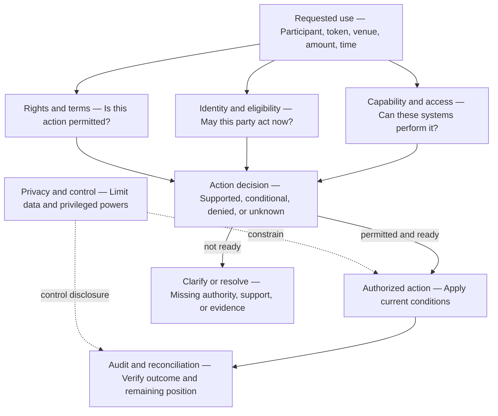

*Rights, participant permission, and operational support must align for the requested use. Disclosure controls qualify execution and evidence. An action can be conditional, rejected, or unresolved as well as supported.*

## 8. Reference Journeys and Validation

**Purpose:** Test the relationship between economic purpose, token actions, functional contracts, and shared attributes through complete examples.

### 8.1 Scenario design and assumptions

For each journey, identify the instrument, participants, authoritative records, funding route, token role, execution environments, interface versions, and trust assumptions. Define what completion means before describing the normal path. Distinguish hypothetical behavior, implemented behavior, and demonstrated behavior.

### 8.2 D-SHARE-style receipt journey

This illustrative journey applies the framing to a share-backed receipt concept. Its rights and controls would have to be defined by the actual programme; it is not a statement about a deployed product.

| ACTOR domain | Capital action | Token and record action | Evidence to inspect |
|---|---|---|---|
| A — Activate | Establish the programme and accept eligible commitments | Define receipt rights, unit ratio, authorities, and issuance conditions | Programme terms, accepted disclosures, participant and authority records |
| C — Channel | Fund an approved purchase route | Transfer accepted money and confirm availability | Funding instructions, conversion records if applicable, usable-funds confirmation |
| T — Transform | Acquire a receipt holding | Mint or allocate authorized units, or transfer existing units, and reconcile the holder record | Backing and issuance evidence where applicable, payment confirmation, ownership record |
| O — Orchestrate | Maintain and service the investment | Reconcile holdings, supply, custody, entitlements, eligibility, and relevant updates | Custody or backing records, register reconciliation, servicing and control events |
| R — Return | Receive income or exit the position | Keep units active for distributions, transfer them on sale, or retire them on permitted redemption | Entitlement record, payment confirmation, remaining position or cancellation evidence |

Two responsibilities may participate in one event: O establishes and maintains a distribution entitlement; R delivers the resulting value and records the payment outcome. Each event should have a primary action and correlated supporting actions rather than being counted twice.

**Figure 12. Receipt example: the same holding can lead to three return outcomes**

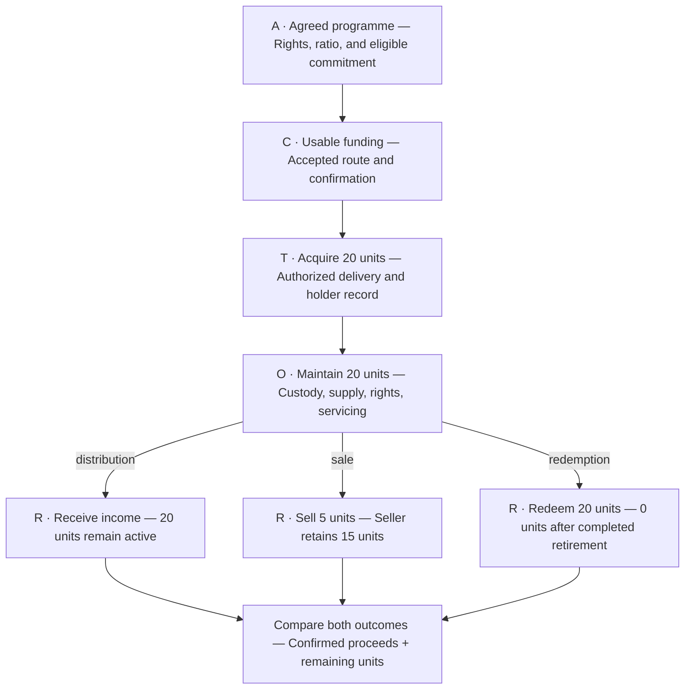

*Illustrative alternatives start from a 20-unit holding. Income leaves 20 units, selling 5 leaves 15 with the seller, and redeeming all 20 can leave zero after completion under the programme terms. These are alternatives, not consecutive transactions.*

### 8.3 Bond acquisition, servicing, and maturity

Describe authorized terms and eligible commitments, accepted funding, acquisition or allocation, holder recognition, coupon entitlement, payment, and maturity. Identify whether the transaction creates new issuance or transfers existing units. Test a distribution while the holding remains active and a final redemption that reconciles both payment and remaining supply under the selected terms.

### 8.4 Tokenized deposit as a funding or payment instrument

Describe the issuing institution and represented obligation, authorized access, balance availability, transfer conditions, and evidence required by the receiving arrangement. Test the distinction between availability inside one system and acceptance by another. Identify external conversion or redemption dependencies explicitly.

### 8.5 Failure and recovery cases

| Trigger | Expected observable behavior | Evidence to inspect |
|---|---|---|
| Terms change after commitment | Detect the version mismatch and apply the stated acceptance rule | Terms history, commitment, decision record |
| Eligibility changes before execution | Refresh or reject stale authorization as required | Credential or policy version, execution decision |
| Funding is delayed | Preserve pending status and handle expiry or release without assuming completion | Funding status, reservation, timeout and case records |
| Only one settlement leg appears complete | Apply the declared exception process and preserve unresolved status | Both leg records, mechanism state, recovery authority |
| A distribution instruction is repeated | Prevent duplicate effect or report the duplicate according to contract | Correlation key, original payment, beneficiary position |
| Backing or register quantities disagree | Flag the difference and invoke the selected restriction and resolution process | Supply, custody or issuer record, case owner |
| Access is lost or compromised | Apply authorized recovery without silently duplicating positions | Authority evidence, recovery approvals, resulting records |

### 8.6 Validation criteria and measures

Assess state-transition correctness, authority enforcement, evidence correlation, duplicate handling, privacy constraints, reconciliation, and recovery. Measure time and cost only for a defined setup. Record where a result depends on an external assertion or operator. A successful case supports the tested configuration, not universal interoperability.

### 8.7 Evidence pack and review result

For each test, preserve the initial state, input, expected outcome, actual outcome, evidence references, environment versions, reviewer, and unresolved issues. Use the result to refine requirements and interface definitions. Proposed tests are research and design work; the edition does not assume an existing certification programme.

**Paragraph sequence:** P1: scenario and assumptions. P2: actors, interfaces, and normal path. P3: exception and recovery behavior. P4: expected and observed evidence. P5: conclusions and remaining limits.

**Reference paragraph:** Reference journeys show whether the architecture can connect a capital action to a verified outcome. Each journey follows the normal transaction and the cases where funding, eligibility, delivery, or servicing fails. Validation compares the expected result with evidence from token records and the relevant external systems. The findings feed back into the interface catalogue and its requirements rather than merely illustrating a successful sequence.

## 9. Conclusions and Next Steps

**Purpose:** Turn the analysis into reviewable findings and a practical research programme.

### 9.1 What the framework clarifies

Explain how ACTOR organizes economic purposes, the common token model describes represented positions, the interface catalogue identifies operations, and the attribute framework evaluates conditions of use. Tie the conclusion back to the opening journey and the requirements register.

### 9.2 Limitations and unresolved design choices

Identify interfaces that need sharper boundaries, evidence that cannot be obtained directly from a ledger, and actions requiring institutional acceptance or external execution. Explain where event semantics, freshness, authority, privacy, or recovery behavior remain undecided. Do not claim completeness merely because the catalogue is broader.

### 9.3 Prioritized community work

First agree on terms and responsibility boundaries; then refine a minimum set of contracts for one complete journey. Review normal and failure outcomes before broadening to further instruments or environments. Assign owners and milestones through the project process rather than inventing commitments in the paper.

### 9.4 Candidate deliverables

| Deliverable | Reviewable outcome |
|---|---|
| Requirements and evidence register | Each gap has an actor, source or scenario, requirement, and evaluation criterion |
| Minimum contract profiles | Inputs, authority, outputs, evidence, and failure semantics for the selected journey |
| Token and position model | Defined roles, states, restrictions, authority, and events |
| Prototype and validation pack | Reproducible cases with observed results and limitations |
| Revision log | Accepted decisions, rejected options with reasons, and remaining questions |

### 9.5 Decision criteria for the next revision

Advance a proposed contract when its responsibility is clear, its result can be evidenced, and its use is demonstrated within a bounded journey. Revise or merge a contract when it duplicates another responsibility. Keep unsupported assumptions visible until evidence resolves them.

**Paragraph sequence:** P1: supported contribution. P2: limitations and tradeoffs. P3: priority questions. P4: next work and deliverables. P5: criteria for revising the proposal.

**Reference paragraph:** The Capital DLC edition proposes a lifecycle-wide way to examine tokenized capital and the interfaces required to make it operable. Its value lies in connecting economic intent, represented claims, authorized actions, and evidence of outcomes. The next revision should be driven by a small number of complete, testable journeys and the unresolved issues they expose. That process can establish which abstractions deserve common specification and which remain instrument- or institution-specific.

**Figure 13. Advance the proposal through evidence and explicit review**

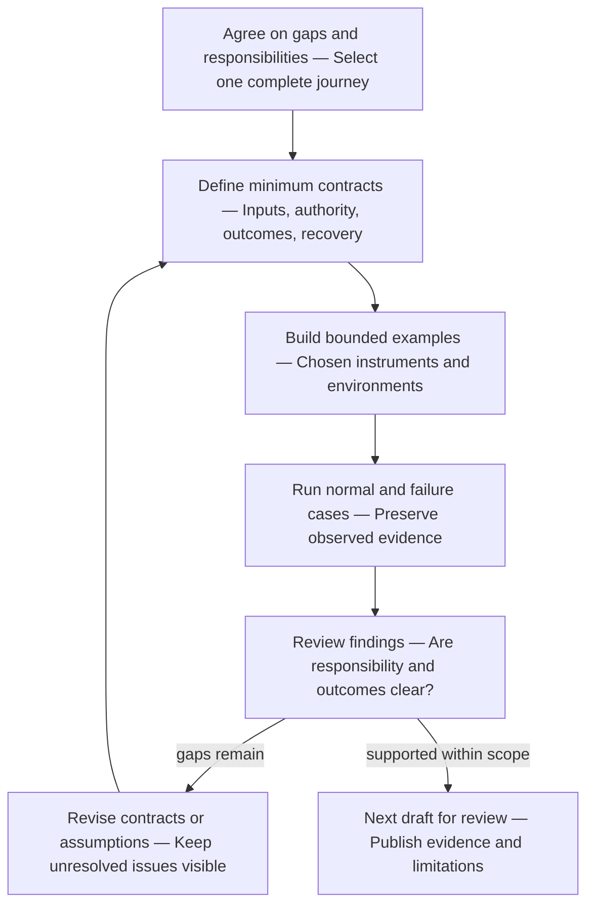

*A bounded journey selects the minimum contracts. Validation can support a revised draft or expose a gap that requires the contracts to change. The diagram represents a proposed research process.*

## Appendix A. Standards Survey and Source Register

Compare selected standards and implementations by token role, state model, authority, supported actions, identity and policy integration, privacy, custody assumptions, and evidence. Record versions and review dates. The source whitepaper [1] supplies a starting survey; newly added interface areas require their own primary-source research before deployment or regulatory claims are made.

For every material factual claim in a developed whitepaper, retain the source, date, relevant passage or evidence, and limitation. Clearly distinguish an official specification, a project claim, and a tested result.

## Appendix B. Reusable Domain Paragraph Template

1. **Capital purpose:** Explain what participants are trying to achieve.
2. **Actors, claims, and token roles:** Identify responsibility and the value or entitlement involved.
3. **Lifecycle actions and interfaces:** Explain state changes and functional dependencies.
4. **Attributes and evidence:** Apply identity, rights, privacy, audit, custody, and relevant conditions.
5. **Outcome and exceptions:** State what completion means, what can fail, and what remains open.

## Appendix C. Research Boundary and Attribution

Capital DLC supplies the broader business and lifecycle framing. OTAS supplies a starting research context for token definitions, behaviors, and interfaces. The proposed additional contracts describe dependencies and candidate areas of standardization; they do not claim to extend the OTAS lab's approved implementation scope. External institutions and platforms remain responsible for instrument obligations, operational execution, custody, policy workflows, and legal determinations [2].

Classify each proposed feature as a token primitive, common interface, external responsibility, or research question. Preserve that classification when evaluating prototypes.

### Sources and attribution

1. Open Tokenized Asset Standard. *Community Whitepaper*. [Source](https://github.com/OpenTokenizedAssetStandard/whitepaper/blob/main/whitepaper.md), reviewed 18 November 2026; file content SHA `8951aae678bbba8e4c23d5b9d53cb330f7d7ae7d`. The repository identifies the whitepaper license as CC-BY-4.0. This proposal adapts its subject grouping and adds the Capital DLC framing.
2. LF Decentralized Trust Labs. *Open Tokenized Asset Standard: scope and deliverables*. [Lab profile](https://lf-decentralized-trust-labs.github.io/labs/approved/otas.html), reviewed 18 November 2026.
3. *OTAS New Edition: Structure and Paragraph Outline*, prior editorial proposal. [Earlier outline](https://chatgpt.com/library?file_id=libfile_f8c5700269a48191b8a47e35e16efa3c&account_id=personal).

Capital DLC and the ACTOR expansions follow the user's project framing. The domain architecture, attribute matrix, lifecycle distinctions, usability criteria, and paragraph outlines in this edition are editorial proposals for discussion.
